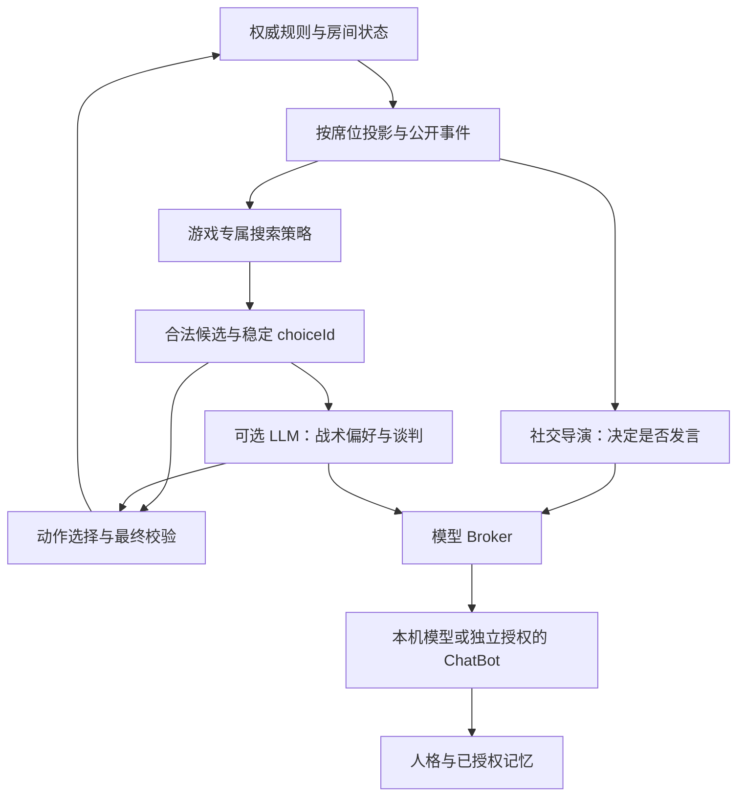

# AI 审查与 ChatBot 联动计划

历史审查快照，日期：2026-11-15。以下缺陷描述和测试数字对应修复前的工作区，不代表当前实现。游戏侧现行入口与验收见 [AI 运行](ai-runtime.md)；ChatBot 问题和联动规划未在本项目修复轮次实施。

审查对象为两份现有工作区：本项目 `8457480` 及其未提交改动；`/Users/xiexie/Documents/ChatBot`（Secho）`b543715` 及其未提交改动。未读取私人对话，未操作界面。既有存档、配置与数据库未修改。模型验收只使用合成测试消息。

## 1. 本轮实际结果

| 检查                                           | 实际结果                                                          | 边界                                                                    |
| ---------------------------------------------- | ----------------------------------------------------------------- | ----------------------------------------------------------------------- |
| 游戏侧 AI、可见信息、配置、Worker 等定向测试   | 53 项通过                                                         | 不代表全游戏平衡已完成                                                  |
| ChatBot 凭据、Provider、记忆权限等定向单元测试 | 33 项通过                                                         | 未执行会清空测试库的集成套件                                            |
| 本轮补充的合成复现与边界检查                   | 8 项完成                                                          | 检查断言用于证明当前缺陷或限制，不能当作修复验收                        |
| ChatBot 私密记忆后台路径                       | 合成 secret 进入抽取提示词；新 secret 传给 embedding 适配器       | 使用内存仓库与假适配器，没有外发真实私密数据；当前实际 embedding 未配置 |
| 假模型 HTTP + 真实房间 WebSocket               | 配置、连接测试、聊天回复通过                                      | 模型本身为假服务                                                        |
| 假模型 LLM 席位                                | 5 次测试操作，版本推进，错误列表为空                              | 不证明真实模型决策强度                                                  |
| 真实 `deepseek-chat` 聊天                      | 已保存加密配置解密成功；连接测试与 AI 聊天通过；整个脚本 1,742 ms | 单次样本，包含本机服务启动；不是模型平均延迟或 P95                      |
| 真实 `deepseek-chat` UNO 选择                  | 8 个候选，LLM 选择实际采用，规则引擎接受，1,015 ms，无回退日志    | 使用合成对局；合法不等于策略正确，UNO 解释存在下述缺陷                  |
| 本机 Ollama                                    | `127.0.0.1:11434` 连接被拒绝                                      | 当前没有在该入口运行的模型服务；未下载模型                              |
| ChatBot 服务                                   | `127.0.0.1:3000` 健康接口连接被拒绝                               | 本轮未启动用户的常驻服务                                                |

凭据仅在真实验收进程内解密，并通过隔离的本机房间服务调用原有 Provider；没有把明文写入文件或命令参数，没有把现有聊天、存档、身份或私密记忆放入请求。ChatBot 环境默认是 fake，但数据库有一份用户级 `deepseek-chat` 加密配置，不能把环境默认值等同于用户实际配置。

本机证据：`.tmp/docs/ai-audit-2026-11-15/`；补充探针 `.tmp/ai-audit-probes.test.ts`、`.tmp/ai-audit-chatbot-memory.mjs`。常规测试入口沿用 [验证索引](verification.md)。这些本机辅助材料不随发行包提供。

## 2. 优先修复的问题

### P0：跨房间模型与记忆没有隔离

[服务端](../src/server/main.ts)只创建一个 TableMind，所有房间使用同一 Runner；[TableMind](../src/server/table-mind/runtime.ts)的时间线和记忆也共用一份。房间 B 配置模型会替换服务级 Provider；没有单独配置的房间也会得到全局 configured 状态。

合成复现：在 A 房间留下唯一标记，再触发 B 房间回复，B 的提示词出现 A 的标记。不是推测，也不需要私人数据才能复现。

处理：按 Room 实例持有 Session，明确 `roomId / playId / seriesId / actorId / providerProfileId`；共享 CPU 池可以保留，Provider 引用、记忆、事件和取消状态必须隔离。房间销毁时释放 Session。跨局公开记忆必须由明确的系列边界授权，不能靠全局数组自然残留。

### P0：AI 私有动作被记作公开事实

[AI 动作提交](../src/domain/room.ts)把审核候选的标签写入统一事件；事件一律标为 public。[麻将候选](../src/domain/mahjong/rules.ts)的换三张标签包含牌面。

真实规则复现：其他玩家投影里的交换牌仍为 null，但 AI 事件已经出现具体“换出”牌名；桌搭子会读取这些标签。正常牌桌投影正确，不能证明提示词边界正确。

处理：由游戏规则产生具有可见性类型的事件，分别投影给公开桌搭子和具体席位。公开描述不能取自审核标签；所有模型入口只接受投影后的事实。以换三张、摸牌、保留牌、秘密身份等生成合成泄漏用例。

### P0：Key 的安全落盘没有覆盖传输授权

[主界面自动同步](../src/main.tsx)仅依据远端快照的 canManage，就从本机安全存储读取 Key 并向当前房间连接发送；角色声明来自正在连接的服务器。代码没有验证该服务是否为本机启动或已绑定的可信服务。

这是静态确认的信任边界问题，本轮没有搭建攻击服务器，也没有向陌生服务器发送任何真实 Key。

处理：本机凭据由本机模型 Broker 使用，不因加入链接或远端角色标志自动外发。远端 ChatBot 使用独立、可撤销、限定用途的授权 Token；如确有把 Provider 凭据托管给服务器的需求，必须独立绑定服务身份。凭据按 Provider 档案及目标 origin 关联，修改目标不得静默复用旧 Key。远端传输使用 HTTPS/WSS，本地调试入口单独限定。

### P1：UNO 给模型的牌面信息解码错误

[UNO 局面解释](../src/domain/table-mind/perspectives/uno.ts)自行用牌号取余作为牌型，与[规则适配器](../src/domain/uno.ts)的权威解码不同。逐张比对：100 张彩色牌有 92 张标签不一致；108 张总牌中占 92 张。例如 ID 7 被解释为红 7，实际为红 4；ID 23 应为 +2，却解释成数字 23。

处理：牌名、牌型、候选参数统一复用规则适配器，不维护第二套编码表；对全部 108 张牌做一致性断言。先修正输入，再评估模型选牌质量。

### P1：生成设置与运行行为不一致

[Runner](../src/server/llm-runner.ts)固定发送 temperature 0.8；调用方显式传入的输出量和时限会绕开用户配置；[决策提示词](../src/domain/table-mind/prompt.ts)和[社交提示词](../src/domain/table-mind/social.ts)固定按 8192 上下文编译。复现中，设置 temperature=0、输出上限 16，实际请求仍为 0.8 和 120。

处理：一次请求解析出唯一的有效配置，统一约束输入预算、输出预算、思考模式、重试和总 deadline。保存测试与真实对局使用同一套配置解析；UI 显示保存、连接可用、实际生效三个不同状态。

### P1：凭据迁移失败会丢失原 Key

[凭据迁移](../src/client/ai-config.ts)在系统凭据保存成功前删掉旧记录，finally 再次删除。模拟凭据存储拒绝写入后，旧 Key 已无法恢复。

处理：成功写入并验证目标记录后再删除旧记录；失败保留重试所需来源并明确告知用户。安全存储写入与非秘密配置保存拆清职责。当前系统凭据保存不回显 Key 的方向保留。

### P1：AI 回放 seed 与实际执行不一致

[AI 动作提交](../src/domain/room.ts)一次动作内递增两次 version。合成复现显示执行使用 `move:v`，回放却记录 `move:v+1`。这会破坏依赖随机数的状态重现；本轮未据此断言所有现存回放均损坏。

处理：真人和 AI 共用一次动作提交事务，执行 seed 与事件使用同一个不可变值；统一版本、事件、回放和派对信号的提交次序。用含随机变化的真实动作验证最终状态逐帧一致。

### P1：ChatBot secret 边界没有覆盖后台流水线

ChatBot [检索器](../../../ChatBot/packages/memory/src/retriever.ts)过滤 secret，但[抽取器](../../../ChatBot/packages/memory/src/extraction.ts)会把已有 secret 放入“已有记忆”提示词，并把新 secret 交给 embedding 适配器。合成探针已复现；当前未启用实际 embedding，不应描述为已发生向量服务泄漏。

处理：在模型外发前统一执行用途与可见性校验，覆盖聊天、抽取、巩固、reflection、embedding 和群聊。secret 不自动外发，去重优先用本地指纹；用户纠正、删除后的旧向量与衍生摘要需要失效或重建。默认禁止私人记忆进入牌桌群聊。

### P2：模型能力、输出解析、生命周期和诊断不足

- [编号解析](../src/server/llm-seat.ts)只提取第一串数字，`-1` 会变成 1，`0.8，最终选择 2` 会变成 0。应使用完整整数校验，或服务端枚举约束的结构化 choiceId。
- 非 UNO 游戏当前主要给模型候选标签和分数，不能称为理解了麻将、卡坦岛等完整局面。按游戏建立可见局面契约，未覆盖时明确标为搜索驱动。
- [本地 Worker](../src/client/local-worker.ts)没有模型运行时；[Gateway](../src/domain/gateway.ts)明确拒绝 ai-config/ai-test。本地搜索 AI 可以运行，但本地对局的 LLM 配置与测试不能按网络房间能力展示。
- 搜索任务可取消，但 Runner 没接房间 AbortSignal，退房、换局、关 AI 后请求仍可能消耗费用；旧社交回复也没有 playId 校验。需要请求级取消与过期结果丢弃。
- Provider 配置仅证明创建了适配器，保存不等于连接成功；现有 Key 清除函数没有设置入口，也没有远端运行时撤销路径。
- 现有适配器错误信息较克制，但 Gemini Key 仍放 URL 查询串；后续改用支持的请求头，并统一 URL、日志、导出与错误脱敏。
- ChatBot 检索在最新 200 条候选内排序，长期记忆超出后可能遗漏旧的重要事实。已有 30 条关键词种子测试不能验证这个规模边界。

## 3. 数据存储目标

| 数据                              | 单一存放方                         | 规则                                                                                        |
| --------------------------------- | ---------------------------------- | ------------------------------------------------------------------------------------------- |
| 本地 Provider Key、设备授权 Token | 系统凭据存储；iOS 使用 Keychain 桥 | UI 只看状态，按 Provider/服务绑定；可撤销，不写普通设置、存档、回放                         |
| 云端用户 Provider Key             | ChatBot 凭据服务                   | 保留 AES-256-GCM；独立 APP_ENCRYPTION_KEY、keyId 和轮换流程；模型服务端使用，游戏拿不到 Key |
| 玩法、难度、显示偏好              | 游戏配置                           | 不混入任何凭据                                                                              |
| 当前手牌、秘密身份、席位私有推理  | 房间权威状态及席位短期上下文       | 只向对应席位投影；牌局结束即失效，不能写公开系列摘要                                        |
| 游戏事件、回放                    | 游戏存储                           | 原始动作与公开事件分离；完整回放导出需明确权限，默认不上传 ChatBot                          |
| 人格、长期关系、跨产品公开经历    | ChatBot                            | 人格版本唯一；游戏只缓存经授权的公开配置与绑定引用                                          |
| 个人私聊与私人记忆                | ChatBot 私人作用域                 | 与同角色的牌桌人格分开；默认不向牌桌检索                                                    |
| 性能、故障与用量                  | 脱敏诊断                           | 默认保存错误码、耗时、用量、版本与是否回退；不默认记录完整 Prompt、回复或手牌               |

实际检查：ChatBot `.env.local` 被 Git 忽略，但文件权限为 0644；未单独配置 APP_ENCRYPTION_KEY，当前凭据依赖认证密钥派生，轮换认证密钥会影响解密。游戏服务器 SQLite 与浏览器 IndexedDB 不提供字段级加密；存档中的恢复 token 属于敏感数据，应限制目录访问，备份加密。不能把“API Key 已加密”扩展成“所有数据已加密”。

存储改造必须采用复制验证、原子替换和可恢复迁移，不先删除旧数据；加密密钥不与数据库备份放在同一个明文包中。明确区分普通缓存、凭据、存档与长期记忆；清缓存不删除后三类。

## 4. 长期游玩的 AI 结构

推荐保留现有可运行的规则/搜索内核，集中修正边界，不让一轮大模型生成替代规则权威。长期体验来自公平、可预测的等待时间、风格差异与适量记忆，不应依靠每步调用更大的模型。

- **实力和人格分开**：难度调搜索预算、误差与风险约束；人设只影响相近候选之间的偏好、发言和合作风格，不授予隐藏信息。
- **按游戏升级**：UNO 完成正确的全牌编码与局面投影后作为基准；合作远征优先做团队意图和资源分工；卡坦岛做有约束的交易谈判；麻将、斗地主继续强化信息集与专属搜索，不默认交给通用文本模型。
- **适应玩家**：按游戏保存熟练度与对局偏好，单次结算限制调整幅度，避免一局输赢让难度突变；不暗中改规则或牌序。
- **记住经历而非堆日志**：经用户授权保存“本局一起击败了哪个 Boss”等公开经历；嘲讽、诈唬、攻击等游戏行为不直接转成现实人格评价或关系惩罚。
- **解释可选**：动作选择需要的候选数据与完整审核记录分开；关闭审核时不生成和存储大段解释。正常界面仅显示正在决策、完成和明确的回退状态。

### 算力使用

当前游戏 AI 是 TypeScript 规则、启发式与有限搜索；已有真实 CPU Worker 池，没有 CUDA/ONNX/神经策略模型路径。RTX 显卡空闲不能证明搜索出了故障，增大线程数也不会自动提高策略质量。

沿用[计算池](../src/domain/compute.ts)并补齐全流程 deadline、候选生成/评分/模拟各段耗时及跨房间公平调度。先改善串行候选生成、数据复制与模拟质量，再调整线程。CPU 搜索与语言模型推理分设选项，不能用一个“硬件加速”开关混淆。

本地语言模型先做小模型量化试点，Ollama/兼容服务负责 GPU 推理，游戏只管理发现、健康、预算和调用。使用 `/api/tags` 确认安装、`/api/ps` 核对驻留与显存；以目标 Windows 机器实测为准，不根据 CPU/GPU 型号承诺帧率或模型速度。参见 [Ollama 模型列表](https://docs.ollama.com/api/tags)、[驻留模型](https://docs.ollama.com/api/ps)。

## 5. 模型接入和能力探测

当前五种格式的适配器定向测试通过，真实验收只覆盖已配置的 DeepSeek，不能标记为所有 OpenAI/Anthropic/Gemini/OpenCode/Ollama 模型均已验证。

统一 Provider 能力表：协议类型、模型 ID、上下文、输出参数、结构化输出、思考模式、流式、取消、用量。选择模型时执行模型发现和最小生成，再验证 choiceId 输出、超时取消；失败状态保留具体阶段及错误码。模型清单和可用状态不能仅靠自由文本填写。

- 普通牌桌对话优先短回复、低延迟、非长思考模式；复盘分析可另设较长预算，不能阻塞真实回合。
- OpenAI 兼容目前固定 Chat Completions、max_tokens、temperature；不能据此承诺兼容所有推理模型。共享适配层应使用成熟 Provider SDK，按能力发送参数，避免堆模型名称特例。[官方推理指南](https://developers.openai.com/api/docs/guides/reasoning)。
- OpenCode Go 官方定位是 coding agent，要求对应流量和稳定会话；当前适配器只解决传输格式，不宜作为休闲牌桌的默认长期服务保证。[官方说明](https://opencode.ai/docs/console/go/)。
- DeepSeek 官方模型列表与别名会更新；本轮实际成功使用 deepseek-chat，后续升级应先探测、再迁移，不能仅凭文档推断现有 Key 或旧模型必定失败。[模型发现](https://api-docs.deepseek.com/api/list-models/)、[更新记录](https://api-docs.deepseek.com/updates/)。

## 6. ChatBot 联动

### 所有权与复用边界

游戏拥有房间、规则、对局、座位、即时私有状态和回放；ChatBot 拥有人格版本、关系、长期记忆、用户模型配置。双方通过版本化契约联动，不读取对方数据库、不复用数据库账号，也不复制聊天服务到游戏中。

复用已有 companion-core 的类型、预算与流式契约。游戏当前版本见[依赖](../package.json)，ChatBot 版本见其 `packages/contracts/package.json` 与 vendor 校验清单；先完成双端兼容检查，再统一共享版本。游戏专属的规则与策略留在游戏侧。ChatBot 已有记忆、关系与人格演进，旧文档所述“记忆尚未开始”不再作为依据。

### 授权与界面

设置 → AI → 连接 ChatBot，打开系统浏览器登录，确认角色与权限后返回；准备界面在 AI 席位上选择已绑定角色。沿用当前设置和房间入口，不增加独立工作台。

桌面端优先授权码 + PKCE；无回调场景可使用设备码。复用 Better Auth 的 OAuth Provider/Device Authorization 插件，不自己写账户、密码或令牌协议。游戏获得限资源授权，不复制 ChatBot 登录 Cookie、数据库权限或模型 Key。参考 [OAuth Provider](https://better-auth.com/docs/plugins/oauth-provider)、[设备授权](https://better-auth.com/docs/plugins/device-authorization)、[原生应用授权规范](https://www.rfc-editor.org/rfc/rfc8252)。

默认只申请角色公开资料读取与桌面场景回复；“写入公开对局经历”单独开启。私聊读取、全量记忆导出、修改人格、读取 Provider Key 不在游戏默认权限内。设备授权可撤销，Token 放系统凭据存储。

### 第一版契约

| 接口职责         | 必须携带的范围与数据                                                 | 不接受的数据                               |
| ---------------- | -------------------------------------------------------------------- | ------------------------------------------ |
| 列出可用角色     | 已授权用户、公开角色摘要、personaVersion                             | 私聊、模型密钥                             |
| 创建牌桌角色会话 | roomId、playId、seriesId、seatId、角色绑定、权限                     | 自报其他用户身份、任意角色越权             |
| 请求回复/选择    | requestId、deadline、可见事实、候选 choiceId、可见性作用域、人格版本 | 完整 RoomArchive、其他玩家手牌、恢复 token |
| 接收结果         | requestId、choiceId 或清洗文本、用量、模型与人格版本                 | 直接写规则状态、执行命令                   |
| 上传对局经历     | eventId、公开事件摘要、来源引用、参与者授权                          | 未授权私聊、隐藏牌、凭空推断的现实人格事实 |
| 撤销绑定与清理   | 用户、设备、会话范围、撤销事件                                       | 仅隐藏 UI 而后台继续使用                   |

事件以 `(roomId, playId, seq)` 去重，带 schemaVersion；每次选择落地前检查房间、局次、版本、座位与候选哈希。没有授权写入时不落长期记忆。

### 长期体验

同一角色可以跨 UNO、远征、卡坦岛保留公开人设和经批准的共同经历；单个玩家的私人关系与群桌形象保持独立。游戏不上传所有对局日志让模型自行“学习”。先生成公开结算摘要，用户可以查看、纠正、删除，并追踪其来源。

离线时继续搜索 AI 与已授权的公开人格缓存；可选经历进入本地 Outbox，恢复连接后去重同步。撤销权限、删除来源时撤掉待同步项目和相应派生内容。缓存无私人记忆，无静默扩大授权。

## 7. 实施批次与验收

| 批次            | 内容                                                                        | 通过条件                                                                                      |
| --------------- | --------------------------------------------------------------------------- | --------------------------------------------------------------------------------------------- |
| A：边界与正确性 | 房间运行时隔离、私有动作投影、Key 不自动外发、迁移、UNO 编码、AI 回放 seed  | 全部合成隔离用例泄漏 0；108 张牌与规则一致；Key 保存失败可恢复；真实随机动作回放逐帧一致      |
| B：运行时统一   | 有效参数、严格输出、取消、预算、Provider 探测、明确本地能力；分离候选与审核 | 非法模型输出均拒绝并回退；退房/停用取消请求；显示的参数与实际请求一致；未支持能力不会显示可用 |
| C：策略与性能   | 每游戏可见局面契约、搜索质量、线程诊断、局间风格与难度                      | 同种子交换座位评测；报告胜率及 95% 区间、违法动作数、P50/P95、回退率、用量，不只报告能走几步  |
| D：绑定角色     | 共享内核升级、设备授权、角色读取、群桌回复、撤销                            | 一个账号绑定一个角色，双人房体验完成；越用户/房间/座位读取为 0；断网仍可游玩                  |
| E：共同经历     | 公开结算、用户确认、Outbox 同步、角色跨游戏延续                             | 重复同步不重复记忆；删除和撤销生效；私聊/隐藏信息绝不混入群桌                                 |

顺序为 A → B → C/D → E。A 未完成前不接跨产品长期记忆。

评测从少量固定合成局面和真实 Worker 定向用例开始；后续离线批量自博弈单独安排，不在开发时运行全量或长时间基准。长期质量评测建议每个试点游戏固定 100 个种子、交换座位，模型与搜索策略独立比较；人工评价趣味性、等待感与说话频率，不能由单次生成成功替代。
