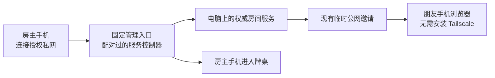

# 手机远程启动电脑服务（待审核）

本页为待审核方案，暂不实施、不安装远程工具、不配置系统服务。房间继续运行在自己的电脑上，不新增云端游戏部署。现有能力与运行入口见 [临时公网房间](hosting.md)、[手机浏览器](mobile-browser-plan.md)；其他体验需求统一见 [体验计划](product-next-plan.md)。

## 推荐选择

先支持「电脑开机、联网、允许后台运行」：近期使用现成远程桌面操作当前客户端，产品阶段接入 Tailscale 私网和手机服务控制页。手机远程控制启动后，再打开游戏邀请链接，用现有手机牌桌游玩。

远程启动软件与远程唤醒电脑是两件事。没有常驻接收者，电脑睡眠／关机后便不能处理手机的启动请求；首版不承诺关机唤醒。

| 路线 | 使用方式 | 前提和取舍 | 建议 |
| --- | --- | --- | --- |
| 现成远程桌面 | 手机用 RustDesk 或 Chrome Remote Desktop 连接电脑，打开本客户端，创建仅服务房间，复制邀请到手机浏览器 | 电脑开机联网，远程工具已配置；需要在手机上操作桌面；连接质量取决于实际网络 | 立即可试，不需要修改本项目；优先试 RustDesk，在自己的移动网络实测 |
| 私网服务控制页 | 手机和电脑安装 Tailscale，手机浏览器打开收藏的控制页，点「启动服务」，再进入牌桌 | 初次需要配对与设备授权；控制电脑的手机需要 Tailscale，受邀玩家仍可用现有公网链接 | 首个开发阶段推荐 |
| 私网内直接玩 | 所有参与手机加入授权私网，直接访问游戏服务 | 每位玩家都要配置 Tailscale；省去临时公网入口，但增加朋友的安装步骤 | 熟人固定小组可选，首版不替代现有邀请 |
| 固定公网入口 | 配置固定域名与命名 Cloudflare Tunnel，或评估 Tailscale Funnel | 需要外部账户／域名或服务配置，需验证规则、可达性与容量；控制页不能随游戏端一起公开 | 后续选配，保留当前临时公网方案 |
| 睡眠唤醒 | 手机访问家中常开的路由器、NAS 或小电脑，由它在局域网发送 WoL，再等主电脑上线 | 主电脑网卡、供电、固件与睡眠状态必须支持；一般优先有线连接；需实测具体型号 | 有合适设备后单独接入 |

RustDesk 的无人值守模式通过固定访问凭据与系统服务实现，不必每次在电脑端确认；Chrome Remote Desktop 支持手机访问电脑。两者的联网能力应在用户实际网络先验证，不作所有网络均可用的承诺。资料：[RustDesk 官方](https://www.rustdesk.com/blog/rustdesk-unattended-access-setup/)、[Chrome Remote Desktop 官方](https://support.google.com/chrome/answer/1649523)。

Tailscale Serve 将本地网页提供给授权私网设备；Funnel 提供公网访问，存在端口、带宽及产品状态限制，暂不作为默认替换。资料：[Serve](https://tailscale.com/docs/reference/tailscale-cli/serve)、[Funnel](https://tailscale.com/kb/1223/funnel)。

WoL 需由另一台在线的局域网设备发出；Tailscale 不直接传递这种二层广播，也不能单独唤醒睡眠电脑。关机唤醒是否可行取决于固件、网卡及供电，不能仅凭 Windows 版本保证。资料：[Tailscale 官方唤醒方案](https://tailscale.com/blog/wake-on-lan-tailscale-upsnap)、[微软电源状态](https://learn.microsoft.com/en-us/windows/win32/power/system-power-states)。

## 首版使用流程

电脑设置中新增「手机远程开房」，用户主动启用后运行首次准备：安装／检查 Tailscale、验证设备连接、准备现有运行组件、配对手机、收藏管理入口，并从移动数据网络完成测试。Tailscale 不静默安装，也不自动创建第三方账户。管理入口使用持久的后台 Serve 配置，验证 Tailscale／电脑重启后的可达性；避免只在命令行窗口存活时可用。

手机控制页只显示电脑在线状态、服务状态、现有房间及「启动服务／继续房间／邀请／结束并停止」。创建房间默认电脑不占席位，复用现有游戏与人数配置。启动成功后直接跳入手机牌桌；失败则显示发生在电脑连接、组件准备、游戏服务或公网隧道中的哪一步，并提供明确的重试入口。

手机连续点击、两个管理页面同时启动、网络重试都必须复用同一启动任务与房间。电脑桌面和手机读取同一个实际服务状态；服务运行、隧道运行、房间存在、对局进行必须分别表达。健康检查通过后才显示可进入；隧道断开不能被误显示为游戏服务已停止。

管理设备与游戏席位分别授权：分享游戏链接不会赋予电脑管理权限；管理页仅对授权私网和已配对设备开放。设备可在电脑端撤销；请求采用经过验证的会话、来源校验与幂等命令，不接受任意命令执行、任意路径或系统关机操作。

## 实现边界

当前原生 [Hosting](../src-tauri/src/hosting.rs) 管理服务与隧道进程，客户端 [退出生命周期](../src-tauri/src/lib.rs) 会停止它们；因此，仅增加网页按钮不足以实现客户端完全退出后的开房。

将运行组件准备、进程监督与状态提取为独立宿主模块，Tauri 和无界面宿主程序共用。资源路径、数据路径和状态通知通过显式依赖传入，核心模块不依赖 AppHandle。宿主是服务进程唯一所有者；桌面界面和手机管理页只提交命令，不再各自维护一套开房进程。

游戏权限和动作继续经 [Gateway](../src/domain/gateway.ts) 与 [Room](../src/domain/room.ts) 执行，不在管理页面复制游戏规则。管理命令与游戏协议分开，控制页不接收私人手牌。服务存档继续使用现有 [SQLite](../src/server/storage.ts)，启动任务与宿主配置另有明确持久化边界，退出、恢复及升级避免同时启动两个数据目录实例。

Windows 11 为首个无人值守目标：使用独立无界面程序作为可选系统服务，支持重启后按授权配置启动，绑定明确的服务账户、数据目录与读写权限。不能将当前 Tauri GUI 直接作为 Windows 服务；系统服务不提供交互桌面。macOS 首阶段使用用户登录会话内的 LaunchAgent；不承诺注销后仍可用，后续另验系统守护进程与网络工具组合。资料：[Windows 服务与交互桌面](https://learn.microsoft.com/en-us/windows/win32/services/interactive-services)、[Tailscale 平台无人值守差异](https://tailscale.com/docs/how-to/run-unattended)。

选配「服务占用期间阻止系统自动睡眠」，显示器仍可关闭。桌面 UI 退出不会停止后台对局；「停止服务」与「退出界面」分别操作。存在进行中对局时停止需要确认，先完成保存；空闲自动停止需用户启用且提前显示倒计时，不自动关闭电脑。

## 分阶段验收

| 阶段 | 交付 | 必须通过 |
| --- | --- | --- |
| A：验证可达性 | 外部远程桌面使用指南、电脑后台服务设置建议 | Windows 11 电脑锁屏时，手机经移动数据连接、开房、邀请另一台手机并完成退出；确认工具可在实际网络使用 |
| B：独立宿主 | 宿主与桌面共用生命周期、组件准备、存档与日志 | 无 GUI 开房；桌面退出后不中断；服务崩溃恢复并明确暂停对局；重复启动不产生孤儿进程、端口或双写存档 |
| C：手机控制页 | 私网入口、配对、启动／恢复／邀请／停止、启动进度 | 手机移动网络连续操作；失联后恢复；同时点击只创建一次；撤销设备后不可控制；游戏邀请不能进入管理页 |
| D：移动稳定性 | 见体验计划 P0，合并验证而非另设连接系统 | iOS／Android 真机：锁屏、切后台、输入法、Wi-Fi 与移动数据切换、服务重启后恢复 |
| E：可选唤醒与固定入口 | 仅在设备型号和接入方案确认后实现 | 局域网唤醒先通过，再测异地唤醒；未上线明确等待／失败；固定入口验证 HTTPS、WSS 与权限隔离 |

自动更新沿用 [更新方案](roadmap.md#自动更新方案待实施)，安装时协调宿主与客户端版本；对局中不强制升级或重启。首版不增加云端游戏部署、语音、浏览器直接执行电脑命令或强制常开屏幕。

## 审核预览

[单页交互预览](../artifacts/review/remote-host-preview.html) 复用现有主题、样式和游戏目录，支持演示启动、进入、邀请、停止及离线状态，不连接真实电脑。它展示管理入口，不替换游戏牌桌；只读演示产物位于本地 artifacts，不属于游戏功能实现。

## 待确定

已确认：暂时没有或不确定是否有常开的路由器／NAS／小电脑，因此首版不依赖额外唤醒设备，不安排采购。电脑离家时的电源状态仍待确定；当前按「Windows 11 开机联网、暂不唤醒、现有临时公网邀请」进行方案评审。正式接入唤醒前再确认具体电脑／网卡与路由器型号、供电及有线连接能力。
